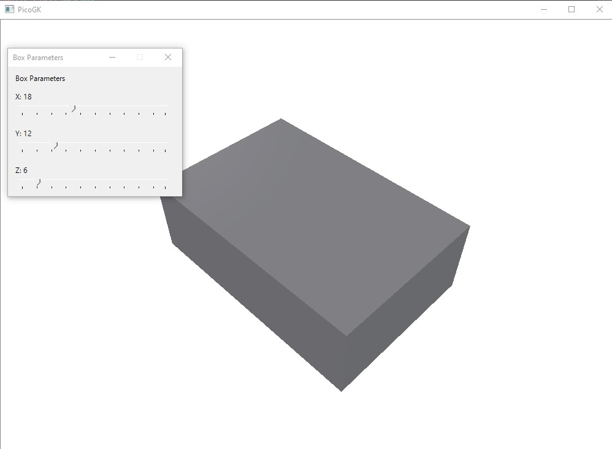

# PicoGK-Configurators
 
Interactive parameter controls (sliders) for [PicoGK](https://github.com/leap71/PicoGK) computational models. The goal is to make parameter changes easy and visible in real time.
 

 
## Status
 
Only one example exists so far:
 
| Example | Parameters |
|---|---|
| `01_Box` | X, Y, Z dimensions in mm (sliders) |
 
## Requirements
 
- Windows (the project targets `net10.0-windows` and uses Windows Forms)
- [.NET 10 SDK](https://dotnet.microsoft.com/download)
- PicoGK NuGet package 2.3.0 (restored automatically)
 
## Getting started
 
```
git clone --recurse-submodules https://github.com/DavidDonelan/PicoGK-Configurators.git
cd PicoGK-Configurators
dotnet run
```
 
If you cloned without `--recurse-submodules`, the `LEAP71_ShapeKernel` folder is empty. Fill it with:
 
```
git submodule update --init
```
 
## About the LEAP71_ShapeKernel submodule
 
[LEAP71_ShapeKernel](https://github.com/leap71/LEAP71_ShapeKernel) is included as a Git submodule, but it points to a fork, not to LEAP 71's repository:
 
- **Submodule URL:** `https://github.com/DavidDonelan/LEAP71_ShapeKernel.git`
- **Pinned commit:** on the fork's branch `fix-image-ambiguity`
 
**What was changed:** `Image` was replaced by `PicoGK.Image` in 3 places:
 
- `ShapeKernel/BaseShapes/BaseLogoBox.cs` (1 place)
- `ShapeKernel/Modulations/SurfaceModulation(2D).cs` (2 places)
 
**Why:** this project enables `ImplicitUsings` and `UseWindowsForms`. The SDK then adds `global using System.Drawing;` to every file, including the ShapeKernel files compiled as part of this project. The bare name `Image` then exists in two namespaces, and the build fails with:
 
```
error CS0104: 'Image' is an ambiguous reference between 'System.Drawing.Image' and 'PicoGK.Image'
```
 
Fully qualifying the name removes the ambiguity. The behavior of the code is unchanged.
 
**Upstream:** a pull request with this change has been submitted to `leap71/LEAP71_ShapeKernel`. If it is merged, the submodule can be switched back to LEAP 71's repository.
 
## License
 
Apache License 2.0, see [LICENSE](LICENSE). The ShapeKernel submodule is by LEAP 71 and keeps its own license.